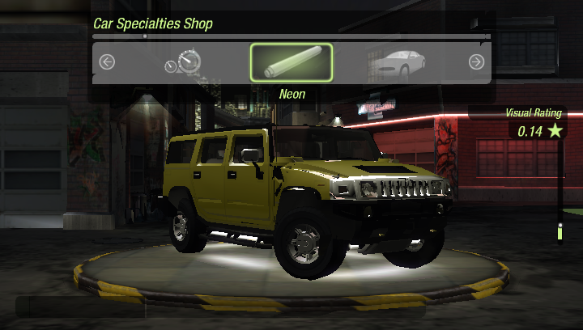

# NFSUG2_Vita

**Need for Speed: Underground 2 on the PlayStation Vita.** A native homebrew
port that runs the original game's data on the console: the city, the cars,
the menus, the HUD and the sounds. There's no emulation and no Wine.

The goal is to make it play like the real game. Menus, HUD, sounds, handling,
camera and controls are rebuilt 1:1 from the shipped game data and from
reverse engineering of the PC executable (`SPEED2.EXE`), rather than
reimagined.

> ⚠️ This repository contains **no game assets** and no EA code. You need
> your own legally acquired copy of NFS: Underground 2 (PC). Not affiliated
> with, authorized or endorsed by Electronic Arts.

Built on top of [OpenUG2](https://github.com/whoismept/OpenUG2), the open,
from-scratch NFSU2 engine by whoismept and contributors. OpenUG2 provides the
asset parsers and the base engine. This project adds the Vita platform layer
and a large amount of game work on top.

## Screenshots

Captured in the Windows simulator of the Vita build (720×408, the Vita's 3D
render size).

| Main menu | Circuit race |
| --- | --- |
|  |  |

| Quick Race track select | Car Specialties Shop |
| --- | --- |
|  |  |

## What works

- **Front end.** The splash screen and main menu come from the game's own
  FEng packages, drawn over the 3D showroom. Quick Race, Customize, Options
  and Credits work. Career, Online and LAN are shown locked.
- **Quick Race.** All seven modes: Circuit, Sprint, Drag, Drift, Street X,
  URL and Free Run. Track and car select, AI opponents, pause and quit, and
  the results screen.
- **AI.** Opponents and traffic run on a port of the game's own racer and
  traffic logic.
- **Driving.** `n2sim` is a port of the `SPEED2.EXE` vehicle handling
  components. On top of it: manual and automatic gearboxes, nitrous, turbo,
  drifting and the original chase camera (CubicCameraMover).
- **Car Shop.** The real shop screens: Body Shop, Performance, Graphics
  (paint, vinyls, decals) and Specialties (neon, spinners, ICE, accents). It
  includes rim brands and sizes and the visual rating. Purchases are saved
  per car.
- **HUD.** Rebuilt from `HUD_SingleRace.fng` with the game's own fonts: tach,
  speedo, nitrous and turbo gauges, minimap with the race route, and race
  standings.
- **Audio.** Per-car engine, turbo, shift, skid and collision sounds from the
  game's own sound banks and the per-car tables in `SPEED2.EXE`. Music is
  supported, with a jukebox.
- **Graphics.** The original world, reflections, bloom, regional fog, car
  particles, and the speed and nitrous blur.
- **World streaming.** The whole city streams seamlessly while you drive,
  from prebuilt world tiles. A worker thread keeps the main thread smooth.

It's still a work in progress. Many features are confirmed on hardware, but
the newest ones have only been checked in the simulator. The main open issue
is memory pressure on long race sessions. Career mode is not built yet.

## Requirements

- A PS Vita with HENkaku/Ensō and VitaShell.
- `libshacccg.suprx` extracted on the console (ShaRKF00D), so shaders can
  compile at runtime.
- The PC version of NFS: Underground 2.

## Installing

1. Install `OpenUG2.vpk` (title ID `OPUG20001`, shown as
   "NFS Underground 2").
2. Copy the game's data folders (`TRACKS`, `CARS`, `GLOBAL`, `FRONTEND`,
   `SOUND`, `LANGUAGES`, ...) to `ux0:data/OpenUG2/`.
3. Optional but recommended: run **UG2Converter.exe** on your PC (see
   [`converter/`](converter/README.md)). It does the one-time "optimizing
   world data" step in about 2 minutes instead of 15–20+ on the console, and
   can send the result to the Vita over FTP.

## Building

Requires a native-Windows [VitaSDK](https://vitasdk.org/). The patched vitaGL
is vendored in `vita/lib/`.

```sh
VITASDK=E:/vitasdk ./vita/build_vita.sh   # -> vita/build/OpenUG2.vpk
./sim/build_sim.sh                        # Windows simulator (sim/README.md)
./converter/build_converter.sh            # UG2Converter.exe
```

## Repository layout

| Path | Contents |
| --- | --- |
| `src/` | Game code: engine, rendering, physics, AI, front end, shop, audio |
| `vita/` | Vita platform layer (SDL subset on vitaGL/SceCtrl/SceAudio), build script, LiveArea assets |
| `sim/` | Windows simulator of the Vita build, for testing flow and UI on PC |
| `converter/` | UG2Converter: PC-side world data conversion + FTP send |
| `tools/` | Asset dump and audit tools, self-tests |
| `docs/` | Format notes, developer guide; [`vita/PORTING_NOTES.md`](vita/PORTING_NOTES.md) covers the Vita specifics |

## Credits and license

- [OpenUG2](https://github.com/whoismept/OpenUG2) by whoismept and
  contributors: the base engine this port is built on.
- [vitaGL](https://github.com/Rinnegatamante/vitaGL) by Rinnegatamante, and
  the VitaSDK team.
- [minimp3](https://github.com/lieff/minimp3).

Code is MIT licensed (see [LICENSE](LICENSE)). Need for Speed and Underground
are trademarks of Electronic Arts. All game content belongs to its owners and
is loaded from your own copy at runtime.
