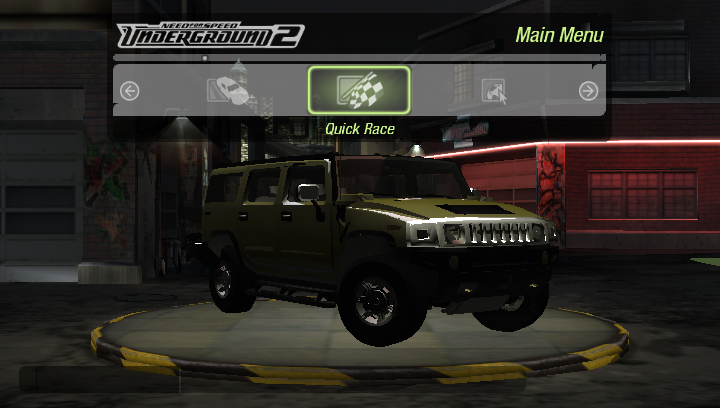
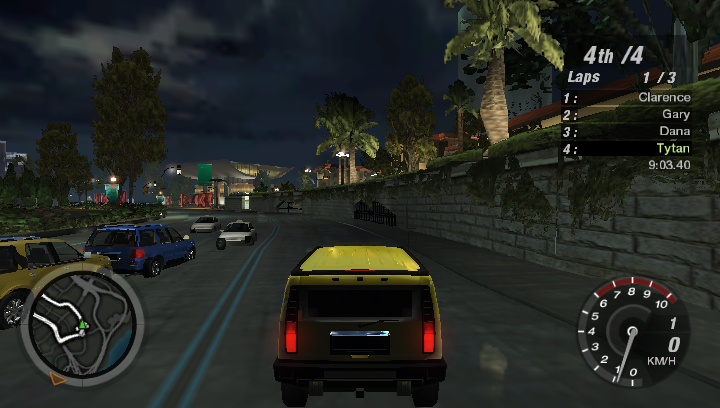
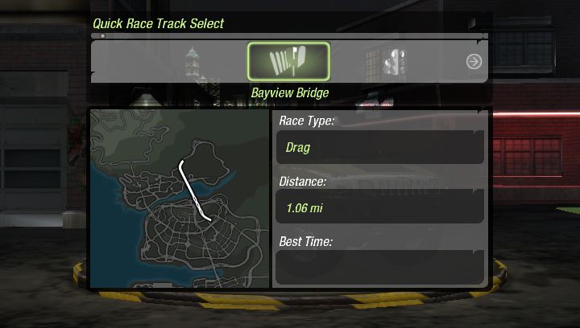

# Need for Speed Underground 2 — Vita Edition

A native PlayStation Vita port of **Need for Speed Underground 2**. It is not
emulation and not a wrapper: the engine is rebuilt in C and runs the PC
game's own data on the console. That covers the city, cars, menus, HUD,
speech, music and movies.

The goal is to play like the real game. Menus, HUD, sounds, handling, camera
and controls are rebuilt 1:1 from the shipped game data and from reverse
engineering of the PC executable (`SPEED2.EXE` v1.2). Nothing is redesigned.

> **Status: in development.** Builds are test builds and may crash or show
> glitches. Many features are confirmed on hardware. The newest ones have so
> far only been checked in the Windows simulator of the Vita build. Please
> report problems with the log files (see [Reporting problems](#reporting-problems)).

> **No game data is included.** This repository has no EA assets and no EA
> code. You need your own legally owned copy of the PC game. This project is
> not affiliated with, authorized or endorsed by Electronic Arts.

| Main menu | Circuit race |
| --- | --- |
|  |  |

| Quick Race track select | Car Specialties Shop |
| --- | --- |
|  |  |

*Screenshots from the Windows simulator, at the Vita's 720×408 3D render size.*

---

## Contents

- [What's in the port](#whats-in-the-port)
- [What you need](#what-you-need)
- [Installation](#installation)
- [UG2Converter (PC tool)](#ug2converter-pc-tool)
- [Bringing over a PC save](#bringing-over-a-pc-save)
- [Settings](#settings)
- [Reporting problems](#reporting-problems)
- [Building from source](#building-from-source)
- [Repository layout](#repository-layout)
- [Credits](#credits)
- [License and legal](#license-and-legal)

---

## What's in the port

- **Career mode.** Free roam of Bayview, the career stages and lock walls,
  races and tournaments, sponsors, SMS messages, the world map and GPS,
  shops found in the city, magazine cover showcases, the crib, the
  status screens, and the career's movies and speech.
- **Quick Race.** Circuit, Sprint, Drag, Drift, Street X, URL, Lap Knockout
  and Free Run, with track and car select, AI opponents and the results
  screen.
- **Driving.** A port of the game's own vehicle handling code, with manual
  and automatic gearboxes, nitrous, turbo, drifting and the original chase
  camera.
- **AI and traffic.** Opponents and traffic run on ports of the game's racer
  and traffic logic.
- **Customization.** The real shop screens: Body Shop, Performance (with the
  dyno), Graphics (paint, vinyls, decals) and Specialties (neon, spinners,
  ICE and more). Includes the visual rating and the Test Track.
- **Front end and HUD.** Built from the game's own FEng menu packages and
  fonts: the main menu over the showroom, profiles and saving, Options,
  Controls, Jukebox and Credits.
- **Audio.** Per-car engine, turbo, shift, skid and collision sounds from the
  game's own sound banks, plus music and speech.
- **Graphics.** The original world shading, car reflections, bloom, regional
  fog, particles, the speed and nitrous blur, and smackable props.
- **World streaming.** The whole city streams in while you drive.
- **Languages.** The game uses the Vita's system language when the original
  game has it. That covers English, French, German, Italian, Spanish, Dutch,
  Swedish and Danish. Other languages fall back to English.

**Not in the port yet:** Online and LAN play, replays and rain.

---

## What you need

### On the PC side

- **Need for Speed Underground 2 for PC, patched to v1.2.** The port only
  reads the data folders, but it is built and tested against v1.2
  (`SPEED2.EXE` dated Feb 9 2005).
- A Windows 10/11 PC for **UG2Converter** (optional, but it saves 15–20
  minutes on the first boot).

### On the Vita side

- A **PS Vita or PS TV** with **HENkaku / Ensō** custom firmware.
- **VitaShell**, to install the VPK and copy files.
- **`libshacccg.suprx`** extracted to `ur0:data/libshacccg.suprx`. The
  renderer compiles its shaders on the console and needs it. If you don't
  have it yet, extract it with **ShaRKBR33D**.
- About **1.7 GB** free on the memory card for the game data, plus about
  **330 MB** for the converted world cache.

---

## Installation

### 1. Install the VPK

Copy `NFSU2Vita.vpk` from the [Releases](https://github.com/elmnt22/vita-nfsu2/releases)
page to your Vita and install it with VitaShell. It shows up as
**NFS Underground 2** (title ID `NFSU20001`).

### 2. Copy the game data

Copy these folders from your PC install (usually
`C:\Program Files (x86)\EA GAMES\Need for Speed Underground 2`) to
**`ux0:data/NFSU2/`** on the Vita:

| Folder | Size | Contents |
|---|---|---|
| `CARS` | 725 MB | cars, parts, vinyls |
| `CREDITS` | 0.5 MB | credits |
| `FRONTEND` | 36 MB | menus and HUD |
| `GLOBAL` | 22 MB | shared game data |
| `LANGUAGES` | 5 MB | game text (copy the whole folder) |
| `MOVIES` | 228 MB | videos |
| `NIS` | 30 MB | in-game cut scenes |
| `SDATA` | 248 MB | speech and music |
| `SOUND` | 22 MB | sound effects |
| `SUBTITLES` | < 1 MB | subtitles |
| `TRACKS` | 388 MB | the city and race tracks |
| `memcard` | < 1 MB | save/load message text |

You don't need the folders `Support`, `Uninstall` and `#JIMBO`.

When you're done, the Vita should have files such as
`ux0:data/NFSU2/TRACKS/STREAML4RA.BUN`.

The layout on the memory card:

```
ux0:data/NFSU2/
├── CARS/  CREDITS/  FRONTEND/  GLOBAL/  LANGUAGES/  MOVIES/
├── NIS/   SDATA/    SOUND/     SUBTITLES/  TRACKS/  memcard/   <- copied from the PC game
├── cache/      <- converted world data, shaders, shop lists (made by the game or UG2Converter)
├── profiles/   <- your saves
└── log.txt, log_prev.txt, boot.txt, crumbs.txt               <- logs
```

### 3. Convert the world data (recommended)

On its first boot the game converts the world data into a format the Vita
can stream quickly. This is the **"OPTIMIZING WORLD DATA"** screen, and on
the console it takes **15–20+ minutes**. **UG2Converter** does the same job
on your PC in about **1½ minutes** and can send the result straight to the
Vita over Wi-Fi. See [UG2Converter](#ug2converter-pc-tool) below.

You can skip this step. The Vita then converts the data itself on the first
boot.

### 4. Play

Start **NFS Underground 2** from the LiveArea.

---

## UG2Converter (PC tool)

`UG2Converter.exe` is a single Windows file with nothing to install. It's on
the [Releases](https://github.com/elmnt22/vita-nfsu2/releases) page. It runs
the port's own conversion code on your PC, so its output is identical to
what the Vita would make. Use the converter from the **same release** as
your VPK. If the data format changes, the Vita ignores cache files from an
older converter and converts the data itself.

**Quick start:**

1. Run **UG2Converter.exe**. It finds your NFSU2 install from the registry.
   If it doesn't, click **Browse...** and pick the game folder (the one with
   `TRACKS` in it).
2. Click **Convert**. It converts all six track sets (the City, both Drag
   Strips, Drift, Street X and URL) and prebuilds the cars' parts lists and
   the shop screens. The result is about 330 MB and goes to a folder called
   `NFSU2 Vita cache`.
3. On the Vita, start an FTP server on port **1337**: in VitaShell, press
   **SELECT**, or use vitacompanion.
4. In the converter, type the IP address the Vita shows and click
   **Send to Vita**. The files go to `ux0:data/NFSU2/cache`.

   To copy the files by hand instead, copy the `cache` folder from the
   output folder into `ux0:data/NFSU2/`.

If it worked, the game goes straight to the title screen without the
"OPTIMIZING WORLD DATA" screen.

The full guide, with the command line options and troubleshooting, is in
**[docs/CONVERTER.md](docs/CONVERTER.md)**.

---

## Bringing over a PC save

UG2Converter can import a career save from the PC game with
**Import PC save...**. The PC game keeps saves in
`%LOCALAPPDATA%\NFS Underground 2\<name>\<name>`. The imported profile is
sent to `ux0:data/NFSU2/profiles` with the rest. Load it from the
**Profile Manager** in the game. See
[docs/CONVERTER.md](docs/CONVERTER.md#importing-a-pc-save).

---

## Settings

Tap **Settings** on the game's LiveArea screen, or hold **L + R** while the
game starts. A small menu opens before the game loads:

| Setting | What it does |
|---|---|
| **Logs** | On by default. Off stops `log.txt` and `perf.csv` from being written. `boot.txt` and `crumbs.txt` are always kept. |
| **Frame rate** | **30 FPS** (default, locked and even) or **Unlocked** (up to 60, varies; experimental). |
| **Reset caches** | Deletes `ux0:data/NFSU2/cache`: the converted world data, shaders and shop lists. Your profiles and options are kept. On the next boot the game converts the world again, or you can send it again from UG2Converter. |

**Start Game** (or START) saves the settings and restarts the game.

The in-game controls use the original game's gamepad defaults. You can
change them in **Options → Controls**.

---

## Reporting problems

Open an [issue](https://github.com/elmnt22/vita-nfsu2/issues). The game
writes its logs to `ux0:data/NFSU2/`:

- `log.txt`: the current run
- `log_prev.txt`: the run before it. The next start overwrites it, so copy
  it first.
- `boot.txt`, `crumbs.txt`: startup and the last steps before a crash

Attach them to the issue, plus a screenshot for a visual problem. For a
converter problem, attach `convert_log.txt` from the converter's output
folder.

---

## Building from source

You only need this to build the port yourself. Players can use the
release files.

**Requirements:** a native-Windows [VitaSDK](https://vitasdk.org/) and a
bash shell (Git Bash works). The simulator and the converter also need
[zig](https://ziglang.org/) (`zig cc`) and SDL2. The patched vitaGL is
included in `vita/lib/`.

```sh
VITASDK=E:/vitasdk ./vita/build_vita.sh   # -> vita/build/NFSU2Vita.vpk (+ eboot.bin)
./sim/build_sim.sh                        # Windows simulator of the Vita build
./converter/build_converter.sh            # -> converter/build/UG2Converter.exe
```

- The **simulator** (`sim/`) runs the Vita build on Windows at the Vita's
  resolution and memory limits, for testing flow and UI without a console.
  See [sim/README.md](sim/README.md).
- [vita/PORTING_NOTES.md](vita/PORTING_NOTES.md) covers the Vita specifics:
  memory, streaming, the renderer, shaders and logs.
- [converter/README.md](converter/README.md) has the converter's developer
  notes, including what it writes and when it needs a rebuild.
- [docs/DEVELOPER_GUIDE.md](docs/DEVELOPER_GUIDE.md) and
  [docs/FORMATS.md](docs/FORMATS.md) cover the engine and the game's file
  formats.

The desktop `Makefile` comes from the OpenUG2 base engine. The port's
supported targets are the three scripts above.

---

## Repository layout

| Path | Contents |
| --- | --- |
| `src/` | Game code: engine, world streaming, rendering, physics (`n2sim`), AI, career, front end (FEng), HUD, shops, audio, speech, movies, profiles |
| `vita/` | Vita platform layer (an SDL subset on vitaGL / SceCtrl / SceAudio), boot settings menu, build script, LiveArea assets, vendored vitaGL |
| `sim/` | Windows simulator of the Vita build, plus self-tests in `sim/test/` |
| `converter/` | UG2Converter: PC-side world conversion, cache builders, PC save import, FTP send |
| `tools/` | Asset dump/audit tools, LiveArea and loading-screen art helpers |
| `docs/` | Player guide for the converter, file format notes, developer guide, screenshots |
| `third_party/` | Dear ImGui (desktop debug UI) |

---

## Credits

- **[OpenUG2](https://github.com/whoismept/OpenUG2)** by **whoismept** and
  contributors. It is the open, from-scratch NFSU2 engine this port is built
  on and provides the asset parsers and the base engine. This repository
  keeps its history.
- **[vitaGL](https://github.com/Rinnegatamante/vitaGL)** by Rinnegatamante,
  and the **[VitaSDK](https://vitasdk.org/)** team.
- **[VitaShell](https://github.com/TheOfficialFloW/VitaShell)** and
  **HENkaku / Ensō** by TheFloW and contributors. Players need them to run
  homebrew.
- **ShaRKBR33D** / **SharkF00D** for extracting `libshacccg.suprx`.
- **[vitacompanion](https://github.com/devnoname120/vitacompanion)** by
  devnoname120, for FTP and remote launch during development.
- **[minimp3](https://github.com/lieff/minimp3)** by lieff.
- **[Dear ImGui](https://github.com/ocornut/imgui)** by Omar Cornut.
- **Electronic Arts / EA Black Box** for the original game.

## License and legal

The code is MIT licensed (see [LICENSE](LICENSE)). Third-party code keeps
its own license.

Need for Speed and Need for Speed Underground 2 are trademarks of Electronic
Arts. All game content belongs to its owners. This project ships none of
it: the port loads the data from your own copy at runtime.
