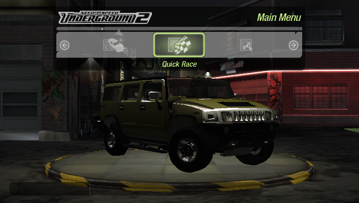
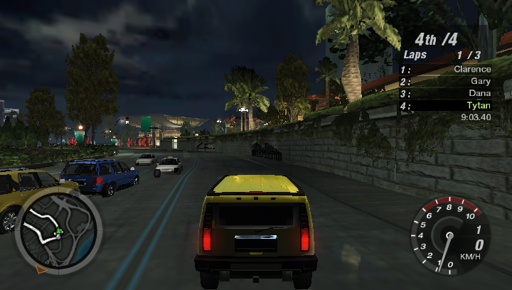
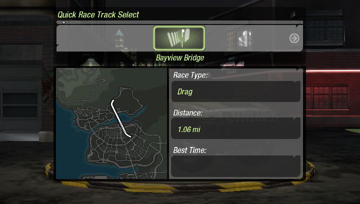
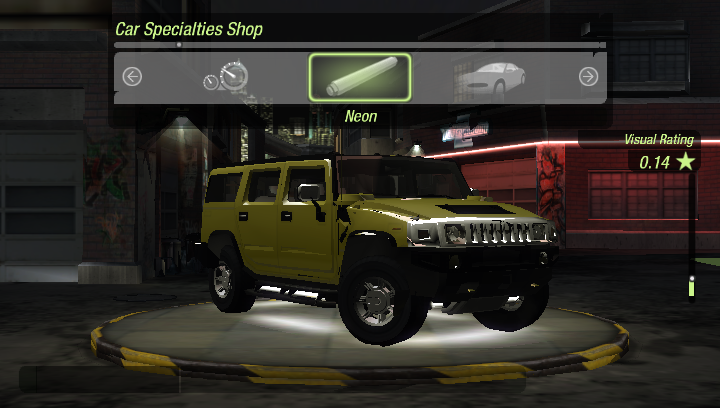

# NFSUG2_Vita screenshots

Captures from the Windows simulator of the Vita build (`sim/`), at the
Vita's 3D render size (720×408). The simulator runs the same game code as
the console; a few sim-only rendering glitches are not present on hardware.

| Capture | What it shows |
| --- | --- |
|  | Front end: the original `UI_Main` strip over the 3D showroom |
|  | Circuit race with AI opponents, original HUD, minimap and traffic |
|  | Quick Race track select with the game's own map and race info |
|  | Car Specialties Shop with neon fitted and the visual rating |
